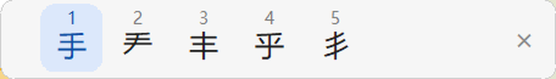

<p align="center">
  
</p>

<h1 align="center">Touchpad Ink · 触控板手写</h1>

<p align="center">把笔记本的精密触控板变成手写板：按住 Alt 写，松开即识别，结果直接进入当前输入框。</p>

<p align="center">
  
  
  
</p>

Touchpad Ink 是一个常驻托盘的小工具。它读取 Windows Precision Touchpad（PTP）的原始触点，交给系统自带的 Windows Ink 识别器，再把候选字用 Unicode 注入当前输入框；也可以把笔画作为左键拖动，直接写进 PowerPoint / WPS 放映和 OneNote 页面。

不模拟手写面板，不安装驱动，不需要管理员权限，识别和日志都只在本机完成。



## 功能

| 模式 | 用法 | 适合 |
| --- | --- | --- |
| 自动识别（推荐） | 每次按住 Alt 时判断一次前台窗口 | 日常混用 |
| 局部打字 | 在光标旁写，边写边识别，点候选或按 1–5 选字 | 浏览器、微信、QQ、Word、编辑器 |
| 全域画图 | 按住 Alt 把触控板映射到鼠标所在显示器 | 白板、截屏讲解 |
| PPT 墨迹 | 按住 Alt 用左键笔迹写入放映中的幻灯片 | PowerPoint / WPS 放映批注 |
| Note 墨迹 | 仅 OneNote 前台时启动，直接写进页面 | OneNote 手写笔记 |

- **自动识别**：OneNote → Note 墨迹；PowerPoint / WPS 全屏放映 → PPT 墨迹；有文本输入位置 → 局部打字；其他情况不弹浮层、不抢鼠标。
- **边写边识别**：不用停笔，候选约每 0.12 秒原地刷新；松开 Alt 后用完整笔画补一次识别。
- **连写**：双按 Alt 进入连写，不必一直按住；数字或点击选字后可以接着写，再双按 Alt 退出。
- **浏览器焦点恢复**：提交前通过 UI Automation 把焦点还给输入框；恢复失败时复制到剪贴板并提示手动粘贴。
- **任意 PTP 设备**：按 HID usage page/usage 发现触控板，用 `HidP_GetValueCaps` 解析描述符，不写死 VID/PID 或报告长度。
- **PPT 区域映射**：以指针为中心建立约三分之一页的局部书写区，掌根不抢笔、不误缩放；每笔从笔尖接着写。

## 环境要求

- Windows 10 / 11，64 位
- 标准 Windows Precision Touchpad（设备管理器里能看到 `0x0D/0x05` 触控板）
- Python 3.10–3.13（开发与打包在 3.13 上验证）
- 不需要管理员权限，不需要安装触控板驱动

> 老式 PS/2 触控板、只上报鼠标位移的兼容模式不支持。部分商务本的触控板在 BIOS 中被设为“基本模式”时也不会暴露 PTP 报告。

## 快速开始（源码）

```bash
git clone https://github.com/Asc-AI/touchpad-ink.git
cd touchpad-ink
python -m pip install -r requirements.txt -i https://mirrors.aliyun.com/pypi/simple/
python tools/tray_app.py
```

也可以双击 `touchpad_tray.bat`。启动后任务栏通知区会出现图标；Windows 11 可能把它收进 `^` 溢出区，可拖到任务栏固定。

1. 点进任意输入框。
2. **按住 Alt**，在触控板上写字；候选条会出现在光标旁并持续刷新。
3. 点候选，或按 **1–5** 选字；松开 Alt 结束本轮。
4. **双按 Alt** 进入连写，**Esc** 取消当前书写，**Ctrl+F8** 退出托盘程序（被占用时用 **Ctrl+Shift+F8**）。

第一次运行会在程序目录旁创建 `data/`，写入 `auto.log`、`ime_input.log` 等诊断文件；删除 `data/` 不影响使用。

## 打包成 exe

目标电脑不需要安装 Python：

```bash
python -m pip install pyinstaller -i https://mirrors.aliyun.com/pypi/simple/
python -m PyInstaller --noconfirm --clean touchpad_tray.spec
python -m PyInstaller --noconfirm touchpad_tray_onefile.spec
```

- `dist/TouchpadInk/TouchpadInk.exe`：文件夹构建，启动快，推荐分发整个文件夹。
- `dist/TouchpadInk.exe`：单文件构建，方便单独拷贝；首次启动会解压到临时目录，较慢。
- 日志、录制数据和图标写在 **exe 旁边的 `data/`**，不会写入临时解压目录。
- 自检：
  - `TouchpadInk.exe --self-check`：创建五种模式与视图
  - `TouchpadInk.exe --ink-check`：实际调用 Windows Ink，打印几个候选

程序未做代码签名，首次运行可能出现 SmartScreen 提示，选择“更多信息 → 仍要运行”即可。

## 工作方式

```text
Precision Touchpad (HID 0x0D/0x05)
        │  Raw Input / HidP_GetData
        ▼
   pad_info + ptp_layout          # 发现设备、解析描述符、归一化坐标
        │
        ├── 局部打字 ──► Windows Ink 识别 ──► Unicode SendInput
        │                    │
        │                    └── 候选条（Tk 透明浮层，不抢焦点）
        │
        ├── 全域画图 ──► 全屏透明画布
        │
        └── PPT / Note ──► 左键拖动注入到目标窗口
```

几个关键点：

- 触控板坐标通过共享的 `pad_info` 映射，所有视图使用同一套动态范围。
- 浮层用颜色键透明 + `WS_EX_NOACTIVATE`，点击穿透，不进入 Alt+Tab。
- 识别器常驻在一个线程里复用，避免反复创建 WinRT 对象导致崩溃。
- PPT/Note 用 `SendInput` 发 `LEFTDOWN/LEFTUP`，笔迹属于目标应用，退出本程序后仍保留。
- 浏览器在 Alt 松开后可能把焦点移到工具栏；程序保存输入框的 UIA 元素，选字前恢复并复查。

## 诊断

```bash
python tools/pad_info.py          # 只读：列出发现的触控板与报告范围
python tools/tray_app.py --self-check
cd tools && python -m unittest    # 完整单元测试
```

日志：

- `data/auto.log`：每次 Alt 的前台判断与最终模式
- `data/ime_input.log`：选字时的目标窗口、焦点、IME 组词状态和注入结果
- `data/tray_console.log`：无控制台构建的启动与错误输出

单测全部使用合成数据和 mock 注入，不会捕获真实鼠标或向其他窗口发送输入。

## 兼容性与限制

- 只支持标准 PTP；并行数组 / 混合布局已有合成单测，尚未覆盖所有厂商。
- 管理员权限窗口可能拒绝 Unicode 注入或焦点恢复。
- 需要按住 Alt 才接管触控板；不按住时触控板仍正常移动鼠标。
- 区域缩小后，单笔行程仍受触控板物理宽度限制；换位置用连写移动或松开重按。
- 未在真实 OneNote / PowerPoint 的所有版本上做端到端书写验证，行为依赖应用自身的笔工具。
- 程序未签名，企业环境请先由管理员确认安全策略。

## 名称与商标

本项目是独立的个人项目，与 Microsoft 没有关联。Windows、Windows Ink、PowerPoint、OneNote 等名称和商标归其各自所有者所有，这里仅用于说明兼容性。项目图标（青色圆角块 + 触控板轮廓 + 珊瑚色笔迹）为原创绘制，随 MIT 协议发布。

## 许可

[MIT](LICENSE)
